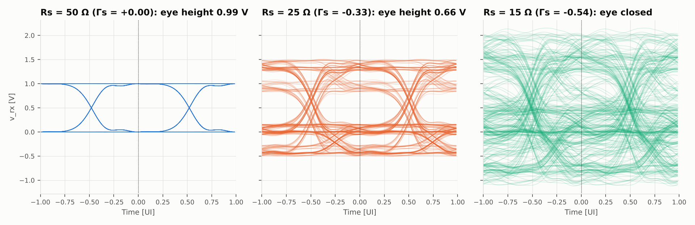
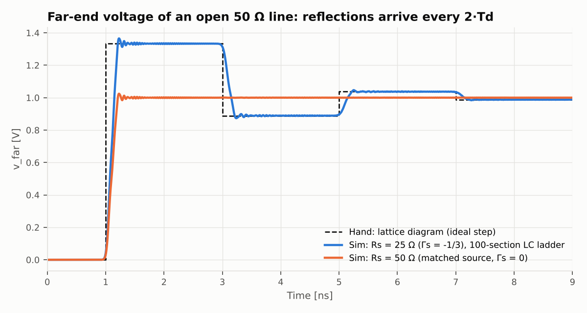

# High-Speed Channel Analysis

회로를 넣으면 행렬로 풀어 주는 작은 SPICE(`minispice`)를 직접 만들고, 그것으로 **배선(채널)이 고속 신호를 얼마나 망가뜨리는지** 분석한다.
선형대수 · 회로이론 · 신호및시스템이 단계마다 하나씩 쓰이고, 결과물은 SI(신호 무결성) 분석의 기본기로 이어진다.

## 진행 방식: 손으로 방향을 잡고, 계산은 기계에 넘긴다

모든 단계가 같은 순서로 돌아간다.

1. **직관** — 무슨 일이 일어날지 먼저 말로 예상한다.
2. **손풀이** — 가장 작은 회로를 수식으로 풀어 숫자 하나를 얻는다. (`notes/`)
3. **시뮬** — 같은 식을 행렬로 일반화한 코드로 큰 회로를 돌린다. (`minispice/`, `experiments/`)
4. **대조** — 손계산 값과 시뮬 값을 표로 맞춰 본다. 어긋나면 어느 가정이 깨졌는지 설명한다. (`tests/`)

| 단계 | 과목 | 손으로 푸는 것 | 시뮬로 미는 것 | 노트 |
|---|---|---|---|---|
| 1. 풀이 엔진 | 선형대수 | 브리지 회로 2×2 크래머 공식, det = 0 의 의미 | 임의 회로의 MNA 행렬, 영공간으로 떠 있는 노드 찾기 | [01](notes/01_노드해석과_행렬.md) |
| 2. 주파수 해석 | 회로이론 | RC·RLC 의 $H(j\omega)$, $f_c$, $Q$, 피크 | $(G+j\omega C)X=B$ 로 보드선도 | [02](notes/02_페이저와_보드선도.md) |
| 3. 과도 응답 | 회로이론 + 선형대수 | $x'=Ax$ 의 고유값, 오버슈트, 반사 격자도 | $\det(G+sC)=0$ 극점, 사다리꼴 적분, 100토막 전송선 | [03](notes/03_상태방정식과_극점.md) |
| 4. 신호 | 신호및시스템 | 클럭의 푸리에 계수, 아이 높이 공식 | FFT, 비트열 ∗ 펄스 응답, 아이 다이어그램 | [04](notes/04_푸리에와_아이다이어그램.md) |

## 핵심 결과

손으로 유도한 식이 시뮬과 맞는다 (전체 표는 각 노트에).

| 손으로 얻은 식 | 손계산 | 시뮬 |
|---|---|---|
| 브리지 노드 전압 $v_b = 2400/385$ | 6.2338 V | 6.2338 V |
| 공진 이득 $\lvert H(f_0)\rvert = Q = \sqrt{L/C}/R$ | 5 | 5.000 |
| 오버슈트 $e^{-\pi\zeta/\sqrt{1-\zeta^2}}$ ($\zeta$ = 0.1) | 72.925 % | 72.925 % |
| 전송선 원단 계단 $4/3,\ 8/9,\ 28/27$ | 1.333 / 0.889 / 1.037 V | 1.334 / 0.889 / 1.036 V |
| 클럭 3차 고조파 $2Vd\,\mathrm{sinc}(nd)\,\mathrm{sinc}(nt_r/T)$ | 0.1822 V | 0.1822 V |
| RC 채널 아이 높이 $1-2e^{-T/\tau}$ ($T=2\tau$) | 0.729 | 0.725 |
| 반사 채널 아이 높이 $\dfrac{(1-\Gamma_s)(1-2\lvert\Gamma_s\rvert)}{1-\lvert\Gamma_s\rvert}$ ($R_s$ = 25 Ω) | 0.667 | 0.664 |

마지막 식에서 나오는 결론: 원단을 종단하지 않은 50 Ω 선로는 드라이버 저항이 $Z_0/3$ = 16.7 Ω 아래로 내려가면 아이가 닫힌다.




## 실행

```bash
pip install -r requirements.txt
```

```bash
python experiments/s1_dc.py          # 1단계: DC 풀이, 특이 회로 진단
python experiments/s2_ac.py          # 2단계: 보드선도
python experiments/s3_transient.py   # 3단계: 극점, 스텝 응답, 전송선 반사
python experiments/s4_signal.py      # 4단계: 클럭 고조파, 아이 다이어그램
```

```bash
python -m pytest -q                  # 손계산 값과 시뮬이 맞는지 19개 항목 확인
```

각 스크립트는 `손계산 | 시뮬 | 오차` 표를 출력하고 그림을 `figures/` 에 저장한다.

## 시뮬레이터 사용법

```python
from minispice import Circuit, add_tline, solve_dc, solve_ac, poles, transient
from minispice.signals import step

ckt = Circuit.from_netlist("""
V1 in 0 1
R1 in m 10
L1 m out 5n
C1 out 0 2p
""")
solve_dc(ckt)                         # {'v(in)': 1.0, 'v(m)': 1.0, 'v(out)': 1.0, ...}
solve_ac(ckt, [1.59e9], "out")        # H(jω)
poles(ckt)                            # det(G + sC) = 0 의 해

ckt = Circuit().V("V1", "s", "0", wave=step(1.0, tr=0.2e-9)).R("Rs", "s", "a", 25)
add_tline(ckt, "T", "a", "b", z0=50, td=1e-9, n=100)
t, res = transient(ckt, t_stop=9e-9, dt=1e-12)
res["b"]                              # 원단 전압 파형
```

## 구조

```
minispice/
  circuit.py     소자 → G, C, B 행렬 (MNA 스탬프), 넷리스트 파서
  analysis.py    DC / AC / 극점 / 과도 해석, 특이 회로 진단
  channel.py     전송선의 LC 사다리 근사
  signals.py     파형, 푸리에 계수, PRBS, 컨볼루션, 아이 측정
experiments/     단계별 실험 (손계산 vs 시뮬 표 + 그림)
notes/           단계별 손풀이 노트 (직관 → 수식 → 대조 → 직접 풀어 볼 것)
tests/           손계산 값을 기준으로 한 검증
figures/         실험이 만든 그림
```

의존성은 numpy(행렬 풀이, 고유값, FFT)와 matplotlib(그림)뿐이다. 회로 해석 부분은 전부 직접 구현했다.

## 한계와 다음 단계

- 선형 소자(R, L, C, 독립 전원)만 다룬다. 다이오드·트랜지스터는 뉴턴 반복이 필요하다.
- 전송선 손실은 다루지 않았다. 표피 효과(√f 손실)와 유전 손실은 주파수에 따라 변하므로 사다리의 직렬 저항만으로는 부족하다.
- 다음 후보: 원단 종단(병렬·테브난) 비교, 두 선로의 누화(상호 인덕턴스·커패시턴스 → 짝/홀 모드 고유값), PDN 임피던스(디커플링 커패시터의 반공진).
