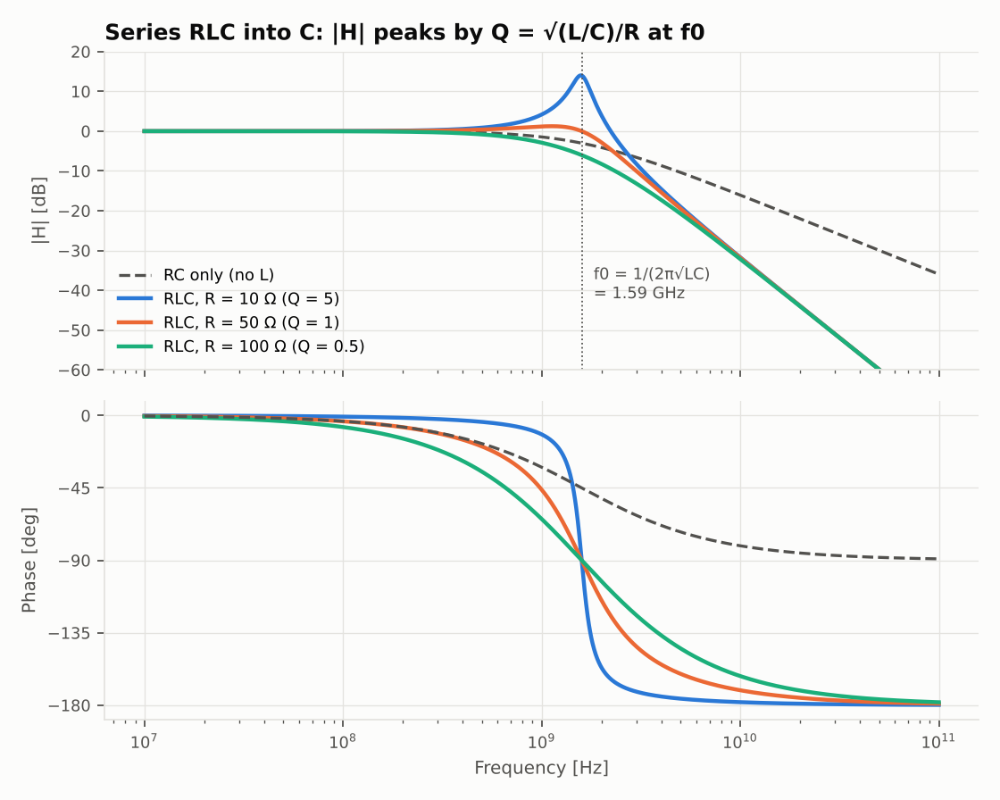

# 2단계 — 페이저와 보드선도 (회로이론)

> 실행: `python experiments/s2_ac.py` · 그림: `figures/s2_bode.png`

## 직관 먼저

- 정현파 정상상태에서는 $d/dt \to j\omega$. 그러면 C 는 $j\omega C$ 짜리 "컨덕턴스", L 은 $j\omega L$ 짜리 "저항"이 되고,
  1단계의 $G\,v=i$ 가 **복소수 행렬** $(G+j\omega C)\,X=B$ 로 바뀔 뿐이다. 주파수마다 한 번씩 풀면 $H(j\omega)$.
- 고속 신호에서 R 은 드라이버 출력 저항, L 은 패키지/본드와이어, C 는 수신단 입력 커패시턴스다.
  L 이 끼면 2차계가 되고, R 이 작으면 공진 피크(= 시간 영역의 링잉)가 생길 것이다.

## 손풀이 1: RC 저역통과 (R = 50 Ω, C = 2 pF)

$$H(j\omega)=\frac{1/j\omega C}{R+1/j\omega C}=\frac{1}{1+j\omega RC},\qquad
|H|=\frac{1}{\sqrt{1+(\omega RC)^2}},\quad \angle H=-\tan^{-1}(\omega RC)$$

$$f_c=\frac{1}{2\pi RC}=\frac{1}{2\pi\cdot50\cdot2\times10^{-12}}=1.59\ \text{GHz}$$

$f_c$ 에서 $|H| = 1/\sqrt2$ (−3 dB), 위상 −45°. 그 위로는 −20 dB/dec.

## 손풀이 2: 직렬 RLC, 출력은 C 양단 (L = 5 nH, C = 2 pF)

$$H(j\omega)=\frac{1}{1-\omega^2LC+j\omega RC}
=\frac{1}{1-(\omega/\omega_0)^2+j\,\dfrac{1}{Q}\dfrac{\omega}{\omega_0}}$$

$$\omega_0=\frac{1}{\sqrt{LC}}=10^{10}\ \text{rad/s}\ (f_0=1.59\ \text{GHz}),\qquad
Q=\frac{1}{R}\sqrt{\frac{L}{C}}=\frac{50\ \Omega}{R}$$

- $\omega=\omega_0$ 를 넣으면 실수부가 사라져 $H = -jQ$ → **공진에서 이득 = Q, 위상 −90°**.
- 피크 위치와 크기($|H|^2$ 의 분모를 $\omega^2$ 로 미분):

$$\omega_{pk}=\omega_0\sqrt{1-\frac{1}{2Q^2}},\qquad |H|_{pk}=\frac{Q}{\sqrt{1-1/4Q^2}}\qquad (Q>1/\sqrt2\ \text{일 때만 피크 존재})$$

- 고주파에서 $|H|\approx(\omega_0/\omega)^2$ → −40 dB/dec.

## 손계산 vs 시뮬

| 항목 | 손계산 | 시뮬 |
|---|---|---|
| RC −3 dB 주파수 | 1.5915 GHz | 1.5922 GHz (주파수 격자 간격 탓) |
| RC $\angle H(f_c)$ | −45° | −45.00° |
| R = 10 Ω: $\lvert H(f_0)\rvert = Q$ | 5 | 5.000 |
| R = 10 Ω: 피크 크기 | 5.0252 (14.0 dB) | 5.0248 |
| R = 10 Ω: 피크 주파수 | 1.5756 GHz | 1.5776 GHz |
| R = 50 Ω: 피크 크기 | 1.1547 | 1.1547 |
| R = 100 Ω: $\lvert H(f_0)\rvert$ | 0.5 (피크 없음) | 0.500 |

**읽는 법**: R = 10 Ω 처럼 드라이버가 강하면(출력 저항이 작으면) 14 dB 피크가 선다. 1.6 GHz 근처 성분이 5배로 커진다는 뜻이고,
3단계에서 이것이 73% 오버슈트로 나타난다. $R = \sqrt{L/C}$ (= 50 Ω) 부근이 "빠르면서 덜 튀는" 지점.

## 직접 풀어 볼 것

1. 출력을 R 양단으로 잡으면 대역통과가 된다. $H$ 를 유도하고 대역폭 $\Delta\omega = \omega_0/Q$ 확인 (`solve_ac` 로 두 노드 전압의 차를 구하면 된다).
2. 수신단 C 에 병렬로 종단 저항 $R_T$ 를 달면 Q 가 어떻게 바뀌나? DC 이득 $R_T/(R+R_T)$ 와 함께 유도.
3. 보드선도 점근선(0 dB 수평선과 −40 dB/dec 직선)을 손으로 그려 놓고 그림과 겹쳐 보기. 꺾이는 점이 $f_0$ 인지.
