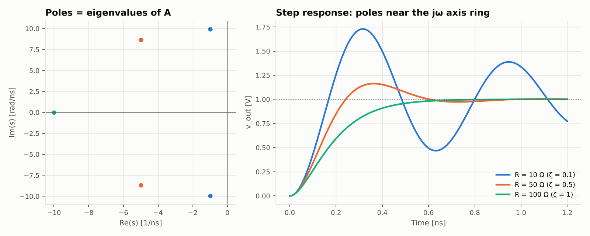
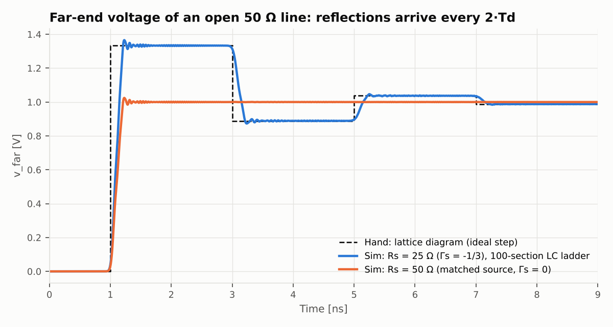

# 3단계 — 상태방정식과 극점 (회로이론 + 선형대수)

> 실행: `python experiments/s3_transient.py` · 그림: `figures/s3_rlc_step.png`, `figures/s3_tline_reflection.png`

## 직관 먼저

- 에너지를 저장하는 소자(C 의 전압, L 의 전류)가 **상태**다. 회로는 $x' = Ax + Bu$.
- 자연 응답은 $e^{\lambda t}$ 의 합이고 $\lambda$ 는 $A$ 의 **고유값**. 실수부 = 감쇠 속도, 허수부 = 링잉 주파수.
  고유값이 허수축에 가까울수록 오래 울린다. 실수부가 양수면 발산(수동 회로에서는 불가능).
- 전송선은 L 과 C 가 끝없이 이어진 것이라 고유값이 아주 많고, 그 합이 "지연 + 반사"로 보인다.

## 손풀이 1: 직렬 RLC 의 상태방정식

상태 $x=[v_C,\ i_L]^{\mathsf T}$. 소자 식 두 개가 곧 상태방정식이다.

$$C\,\dot v_C=i_L,\qquad L\,\dot i_L=v_{in}-R\,i_L-v_C
\quad\Longrightarrow\quad
\dot x=\underbrace{\begin{bmatrix}0&1/C\\-1/L&-R/L\end{bmatrix}}_{A}x+\begin{bmatrix}0\\1/L\end{bmatrix}v_{in}$$

특성방정식 $\det(\lambda I-A)=0$:

$$\lambda^2+\frac{R}{L}\lambda+\frac{1}{LC}=0\quad\Longrightarrow\quad
\lambda=-\alpha\pm\sqrt{\alpha^2-\omega_0^2},\qquad \alpha=\frac{R}{2L},\ \ \omega_0=\frac{1}{\sqrt{LC}}$$

감쇠비 $\zeta=\alpha/\omega_0=\dfrac{R}{2}\sqrt{\dfrac{C}{L}}$ ($=1/2Q$, 2단계와 연결).

| $\zeta$ | 고유값 | 응답 |
|---|---|---|
| < 1 | 켤레복소수 $-\alpha\pm j\omega_d$, $\omega_d=\omega_0\sqrt{1-\zeta^2}$ | 링잉 |
| = 1 | 중근 $-\omega_0$ | 임계 감쇠 ($R = 2\sqrt{L/C}$) |
| > 1 | 서로 다른 두 음의 실수 | 느리게 수렴 |

부족 감쇠 스텝 응답과 거기서 나오는 두 숫자:

$$v_C(t)=1-e^{-\alpha t}\Big(\cos\omega_dt+\frac{\alpha}{\omega_d}\sin\omega_dt\Big),\qquad
t_{pk}=\frac{\pi}{\omega_d},\qquad \text{오버슈트}=e^{-\pi\zeta/\sqrt{1-\zeta^2}}$$

**숫자 (L = 5 nH, C = 2 pF, $\omega_0 = 10^{10}$ rad/s)** — R = 10 Ω 이면 $\alpha = 10^9$, $\zeta = 0.1$,
$\omega_d = 9.95\times10^9$, $t_{pk} = 316$ ps, 오버슈트 $e^{-0.3157} = 72.9\%$. 임계 감쇠는 R = 100 Ω.

**MNA 에서 극점 뽑기** — 시뮬레이터는 상태방정식을 따로 세우지 않는다. $Gx + C\dot x = 0$ 에 $x = ve^{st}$ 를 넣으면
$(G+sC)v=0$, 즉 $\det(G+sC)=0$ 인 $s$ 가 극점이다(일반화 고유값 문제). 손으로 세운 $A$ 의 고유값과 같아야 한다.

## 손풀이 2: 전송선의 반사 (격자도)

$Z_0 = 50\ \Omega$, 지연 $T_d = 1$ ns, 소스 저항 $R_s = 25\ \Omega$, 원단 개방. 1 V 스텝.

$$V_0=\frac{Z_0}{R_s+Z_0}=\frac23,\qquad
\Gamma_L=\frac{Z_L-Z_0}{Z_L+Z_0}\Big|_{Z_L\to\infty}=+1,\qquad
\Gamma_s=\frac{R_s-Z_0}{R_s+Z_0}=-\frac13$$

원단 전압은 파가 도착할 때마다(입사 + 반사 = $(1+\Gamma_L)$ 배) 쌓인다:

| 시각 | 도착하는 파 | 원단 전압 |
|---|---|---|
| $T_d$ | $V_0$ | $2\cdot\frac23=\frac43=1.333$ |
| $3T_d$ | $V_0\Gamma_L\Gamma_s=-\frac29$ | $\frac43-\frac49=\frac89=0.889$ |
| $5T_d$ | $V_0(\Gamma_L\Gamma_s)^2=\frac{2}{27}$ | $\frac89+\frac{4}{27}=\frac{28}{27}=1.037$ |
| $7T_d$ | $V_0(\Gamma_L\Gamma_s)^3$ | $\frac{80}{81}=0.988$ |

등비급수의 합 $\dfrac{2V_0}{1-\Gamma_L\Gamma_s}=\dfrac{4/3}{4/3}=1$ → 결국 DC 값 1 V 로 수렴(전류가 0 이니 당연).
$R_s = Z_0$ 면 $\Gamma_s = 0$ 이라 첫 도착에서 바로 1 V 로 끝난다(소스 직렬 종단).

**시뮬에서 전송선 만들기** — 선로를 N 토막으로 잘라 토막마다 $L_{seg}=Z_0T_d/N$, $C_{seg}=T_d/(Z_0N)$.
($Z_0=\sqrt{L/C}$, $T_d=\sqrt{L_{tot}C_{tot}}$ 에서 역산.) 사다리는 $f_c = N/(\pi T_d)$ 위를 못 지나가므로
상승 시간 $t_r$ 에 대해 $N\gtrsim10\,T_d/t_r$ 로 잡는다. 여기서는 N = 100, $t_r$ = 0.2 ns.

## 손계산 vs 시뮬

| 항목 | 손계산 | 시뮬 |
|---|---|---|
| R = 10 Ω 극점 | $-1 \pm j9.9499$ (1/ns) | $-1 \pm j9.9499$ |
| R = 10 Ω 오버슈트 | 72.925 % | 72.925 % |
| R = 10 Ω 첫 피크 | 315.74 ps | 315.8 ps |
| R = 50 Ω 오버슈트 | 16.303 % | 16.303 % |
| R = 100 Ω 극점 | 중근 −10 | −10, −10 |
| 원단 계단 1~4 | 1.3333 / 0.8889 / 1.0370 / 0.9877 V | 1.3342 / 0.8886 / 1.0355 / 0.9873 V |

계단 모서리의 잔물결은 실제 현상이 아니라 **사다리 근사의 흔적**이다(토막 수가 유한해서 생기는 차단 주파수 근처 성분). N 을 키우면 줄어든다.

## 직접 풀어 볼 것

1. 원단에 $R_T = 50\ \Omega$ 병렬 종단을 달면 $\Gamma_L = 0$. 원단 전압은 얼마에서 멈추나? (DC 분압과 같은지)
2. $R_s = 100\ \Omega$ ($\Gamma_s = +1/3$) 이면 계단이 진동하지 않고 단조 증가한다. 격자도로 처음 세 값을 구하고 시뮬과 비교.
3. LC 사다리 2토막만 손으로 상태방정식을 세워 고유값 4개를 구해 보기. 토막 수가 늘면 고유값이 허수축 위에 어떻게 늘어서는지 `poles()` 로 그려 보기.
4. 오일러 전진법으로 RLC 를 풀면 스텝 크기가 클 때 발산한다. $|1+h\lambda|<1$ 조건에서 한계 $h$ 를 유도. (사다리꼴은 왜 항상 안정한가?)
