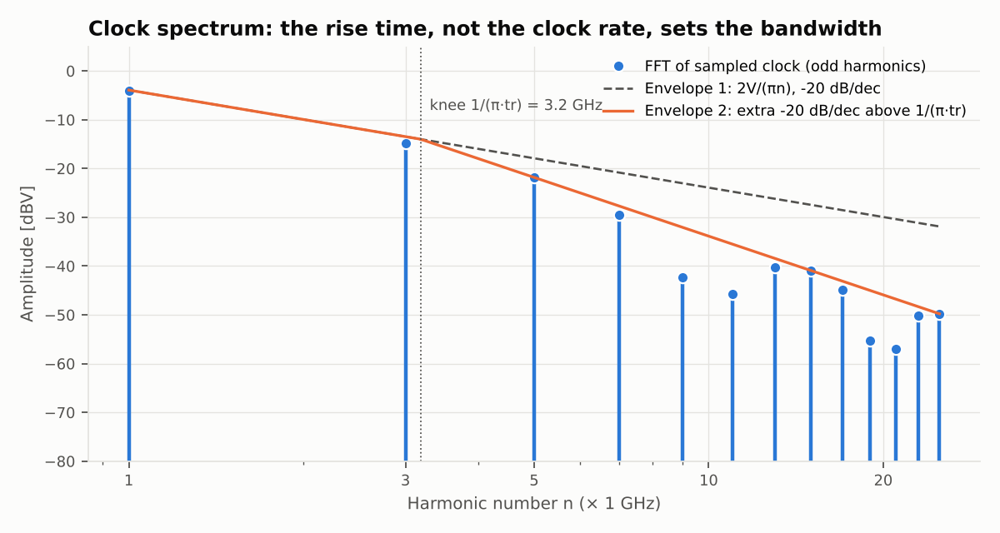
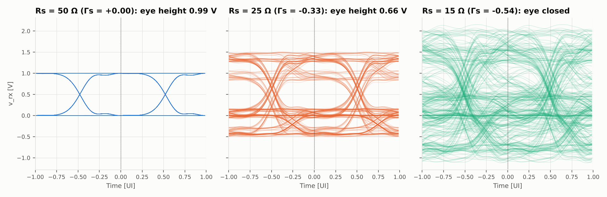
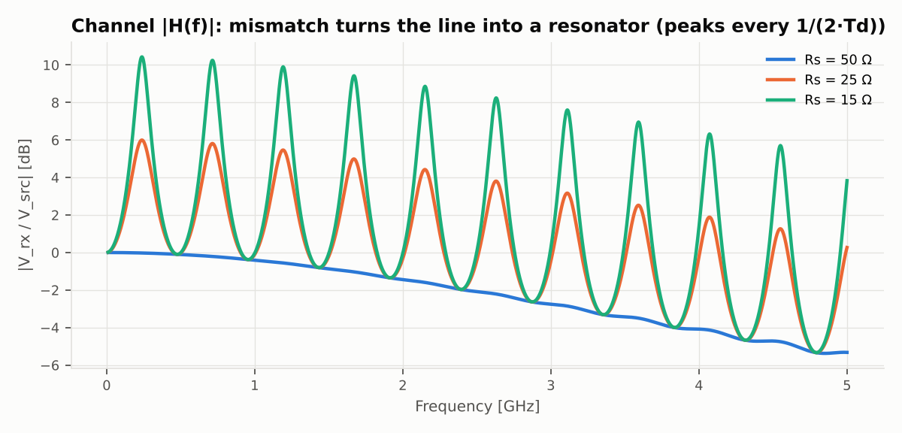

# 4단계 — 푸리에 급수와 아이 다이어그램 (신호및시스템)

> 실행: `python experiments/s4_signal.py` · 그림: `figures/s4_clock_harmonics.png`, `figures/s4_eye.png`, `figures/s4_channel_response.png`

## 직관 먼저

- 클럭은 주기 신호 → 푸리에 급수. 채널이 고조파를 깎으면 모서리가 뭉개진다. **몇 차 고조파까지 살려야 하나**는 클럭 주파수보다 상승 시간이 정한다.
- 채널은 LTI 다. 비트열은 "펄스 하나"를 한 비트씩 밀어 더한 것이므로, 출력도 **펄스 응답**을 밀어 더한 것(컨볼루션)이다.
  펄스 응답이 한 비트 안에 끝나지 않으면 꼬리가 다음 비트를 건드린다 = ISI. 아이 다이어그램은 그 최악의 경우를 한 장에 겹쳐 보는 그림.

## 손풀이 1: 사다리꼴 클럭의 푸리에 계수

진폭 $V$, 주기 $T$, 듀티 $d$(50% 지점 기준), 상승·하강 시간 $t_r$.
사다리꼴은 **폭 $dT$ 인 사각 펄스 ∗ 폭 $t_r$ 인 사각 펄스(넓이 1)** 이고, 시간 영역 컨볼루션은 계수의 곱이므로

$$|c_n|=V\,d\;\big|\mathrm{sinc}(nd)\big|\;\big|\mathrm{sinc}(n\,t_r/T)\big|,\qquad \mathrm{sinc}(x)=\frac{\sin\pi x}{\pi x}$$

n차 고조파의 진폭은 $2|c_n|$. 여기서 읽을 것:

- $d = 1/2$ 이면 $\mathrm{sinc}(n/2)=0$ (짝수 n) → **홀수 고조파만** 남는다. $2|c_n|\approx\dfrac{2V}{\pi n}$ : −20 dB/dec.
- 둘째 sinc 는 $n\,t_r/T \gtrsim 1/\pi$, 즉 $f\gtrsim\dfrac{1}{\pi t_r}$ 부터 추가로 −20 dB/dec. → 대역폭은 $t_r$ 이 정한다.
- $n = T/t_r$ 에서 영점.

**숫자 (1 GHz, $t_r$ = 100 ps)**: $2|c_1| = 2\cdot0.5\cdot\frac{2}{\pi}\cdot\mathrm{sinc}(0.1)=0.6366\times0.9836=0.6262$ V.
무릎 주파수 $1/(\pi t_r)=3.2$ GHz, 영점은 10차.

## 손풀이 2: RC 채널의 아이 높이

NRZ, 비트 폭 $T$, 채널 시정수 $\tau = RC$, 비트 끝에서 샘플링.

- 가장 낮은 "1": 0 이 오래 이어지다 1 이 한 번 → $1-e^{-T/\tau}$
- 가장 높은 "0": 1 이 오래 이어지다 0 이 한 번 → $e^{-T/\tau}$

$$\text{아이 높이}=1-2e^{-T/\tau},\qquad \text{닫히는 조건: } T=\tau\ln2\ \Rightarrow\ \text{최대 전송률}=\frac{1}{0.693\,RC}$$

R = 50 Ω, C = 2 pF ($\tau$ = 100 ps) 이면 한계는 14.4 Gbps.

## 손풀이 3: 반사가 있는 채널의 아이 높이

3단계의 선로($Z_0$, $T_d$, 원단 개방)에 폭 $T$ 인 펄스를 넣으면 원단에는

$$\text{주 펄스 } a_0=1-\Gamma_s,\qquad \text{메아리 } a_k=(1-\Gamma_s)\,\Gamma_s^{\,k}\ \ (2kT_d\ \text{뒤})$$

($a_0 = 2V_0 = 2Z_0/(R_s+Z_0) = 1-\Gamma_s$.) 일반적으로 최악의 아이 높이는 **주 펄스 − Σ|나머지|** 이다
(메아리의 부호에 맞춰 이전 비트들이 전부 불리하게 놓인 경우). 등비급수로

$$\text{아이 높이}=(1-\Gamma_s)\Big(1-\frac{|\Gamma_s|}{1-|\Gamma_s|}\Big)=\frac{(1-\Gamma_s)(1-2|\Gamma_s|)}{1-|\Gamma_s|}$$

$$\text{닫히는 조건: } |\Gamma_s|=\tfrac12\ \Longleftrightarrow\ R_s=Z_0/3\ \text{또는}\ 3Z_0$$

50 Ω 선로면 드라이버가 16.7 Ω 보다 강해지는 순간 (원단을 종단하지 않는 한) 전송률과 무관하게 아이가 닫힌다.
단, 이 식은 메아리가 샘플링 시점에 정확히 겹칠 때($2T_d$ 가 $T$ 의 정수배. 여기서는 5배)의 값이다.

## 컨볼루션이 맞는지

$$y(t)=\sum_k b_k\,p(t-kT)\qquad(p:\ \text{펄스 응답, 과도 해석 한 번으로 구함})$$

같은 비트열을 통째로 과도 해석한 결과와 비교하면 RC 채널에서 차이 $10^{-15}$ V 수준(반올림 오차),
전송선 채널에서 $10^{-4}$ V 이하(펄스 응답을 150 UI 에서 자른 탓). 과도 해석 한 번 + 컨볼루션으로 수천 비트를 볼 수 있는 이유다.

## 손계산 vs 시뮬

| 항목 | 손계산 | 시뮬 |
|---|---|---|
| 클럭 1 / 3 / 5차 진폭 | 0.6262 / 0.1822 / 0.0811 V | 0.6262 / 0.1822 / 0.0811 V |
| 클럭 10차 | 0 | 0 |
| RC 아이, $T=4\tau$ (2.5 Gbps) | 0.9634 | 0.9622 |
| RC 아이, $T=2\tau$ (5 Gbps) | 0.7293 | 0.7251 |
| RC 아이, $T=\tau$ (10 Gbps) | 0.2642 | 0.2596 |
| 선로 아이, $R_s$ = 50 Ω | 1 | 0.992 |
| 선로 아이, $R_s$ = 25 Ω | 2/3 = 0.667 | 0.664 |
| 선로 아이, $R_s$ = 15 Ω | −0.256 (닫힘) | −0.186 (닫힘) |

차이가 나는 이유: RC 쪽은 PRBS7 에 0 이 최대 6개까지만 연속으로 나와 "무한히 긴 0" 이 아니기 때문.
선로 쪽은 손 공식이 수신단 1 pF 과 상승 시간을 무시했고, 15 Ω 은 3000 비트 안에 최악 패턴이 다 나오지 않았기 때문.

마지막 그림은 같은 채널을 2단계 방식으로 본 것. 부정합이면 약 $1/(4T_d)$ = 250 MHz 부터 약 500 MHz 간격으로 피크가 서고(수신단 C 때문에 조금씩 낮다),
이 피크들이 시간 영역에서는 5 UI 간격의 메아리다. **주파수 영역의 공진 = 시간 영역의 반사**.

## 직접 풀어 볼 것

1. 듀티가 50% 에서 조금 벗어나면(예: 45%) 짝수 고조파가 살아난다. 2차 고조파 진폭을 손으로 구하고 FFT 와 비교.
2. 채널이 1차 저역통과일 때 클럭 출력의 n차 진폭은 $2|c_n|\cdot|H(jn\omega_0)|$. 3차가 절반으로 줄어드는 $\tau$ 는?
3. 원단에 $R_T = Z_0$ 병렬 종단을 달면 $\Gamma_L = 0$ 이 되어 메아리가 사라진다. 대신 신호 크기는? 아이 높이 식을 다시 유도하고 시뮬로 확인.
4. $2T_d$ 가 UI 의 정수배가 아닐 때(예: UI = 0.45 ns) 메아리가 비트 경계에 걸친다. 아이 높이와 폭 중 무엇이 더 나빠질지 먼저 예상하고 돌려 보기.
